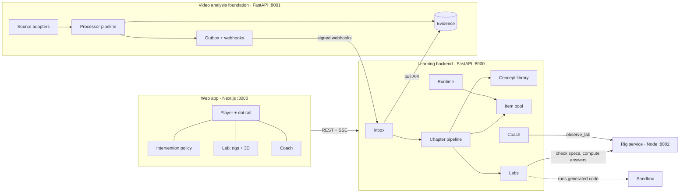

# SeeDots

**See the dots. Connect them.**

English | [简体中文](README.zh-CN.md)


SeeDots adds an AI learning layer to the lecture video you are already watching. At the right
moment it offers a learning action you can check (a question, a prediction, an experiment, a
rewatch), every answer points back to an exact moment in the video, and concepts you meet in
different videos are linked into one knowledge map.

> **Status:** pre-alpha, built for a competition MVP (target: November 2026). APIs and data
> models change without notice. Video content is English-only for now.

## Table of contents

- [Features](#features)
- [How it works](#how-it-works)
- [Getting started](#getting-started)
- [Configuration](#configuration)
- [Running the tests](#running-the-tests)
- [Project structure](#project-structure)
- [Documentation](#documentation)
- [Design principles](#design-principles)
- [Known gaps and roadmap](#known-gaps-and-roadmap)
- [Contributing](#contributing)
- [License](#license)
- [Acknowledgements](#acknowledgements)

## Features

- **Any video in.** Add a YouTube link (official embedded player, captions only, never
  downloaded), upload a file with optional captions, or grab a video from a web page you have the
  rights to use. Videos without captions go through speech recognition if configured.
- **Questions prepared before you need them.** Each chapter is turned into concepts and a pool
  of validated items: single and multiple choice, find the error, predict, ordering and matching.
  Every item cites the transcript sentences that support it.
- **Interruptions that respect you.** The player watches for natural pauses, rewinds, skips and
  "confused" marks. The front end decides *when* an interruption is acceptable (rate limit,
  focus mode, muting after dismissals); the backend decides *what* to show.
- **AI Coach.** A streaming tutor that answers about the moment you are at, cites clickable
  timestamps, flags anything not from the video, and can look up where you met a concept in
  your other videos. Answers render as Markdown with LaTeX.
- **Labs.** Predict, try, observe, explain, and make things happen or find the rule. Each chapter
  gets a lab built on one of 12 prebuilt rigs (functions, iterations, vectors, distributions,
  sampling, contour maps, motion, optics, stocks and flows, genetic crosses, sun and seasons,
  timelines), several with a 3D view. A rig service checks every lab and computes its answers. On
  request, an agent builds a custom lab: it tries the rigs first and writes sandboxed code only when
  no rig fits. The Coach can run a chapter's lab to answer "what if" questions with computed numbers.
- **Knowledge map.** Concepts are merged across videos into a global library; you get a map,
  concept pages, search, and knowledge cards you confirm yourself.
- **Observable model use.** Every model call goes through one gateway with versioned prompts,
  typed outputs, caching, budgets, and a usage log (`GET /api/usage`).

## How it works



1. The **foundation** (`services/seedots/media`) turns any video into time-stamped *evidence*
   (sentences, chapters, keyframes). It knows nothing about learning.
2. The **learning backend** (`services/seedots/learning`) consumes chapter events and generates
   concepts, items and scenes offline, chapter by chapter, starting from the playback position.
3. While you watch, the **runtime** only looks things up: it picks an action and an item from
   the pre-built pool. Online model calls are limited to the Coach, action selection and
   knowledge-card drafts.

Both services own their own database, workflows and model gateway, and talk only over HTTP and
signed webhooks. See the [technical plan](docs/tech-plan.md) for the full design.

## Getting started

### Prerequisites

- macOS or Linux
- Python 3.11+
- Node.js 22.18+ (the rig service runs TypeScript directly)
- ffmpeg
- Google Chrome (only for L2 interactive scenes, which use it headlessly)
- An API key for an OpenAI-compatible endpoint (default: [TokenRouter](https://www.tokenrouter.com)).
  Without a key you can still run everything against an offline fake model.

### Install

```bash
git clone https://github.com/JerryLinyx/seedots.git
cd seedots
cp .env.example .env            # set SEEDOTS_LLM_API_KEY, or SEEDOTS_LLM_FAKE=1 to run offline

# backend
cd services && python3 -m venv .venv && .venv/bin/pip install -e '.[dev]' && cd ..

# web app
cd apps/web && npm install && cd ..

# optional
(cd services/scenekit && npm install)   # L2 interactive scenes (headless Chrome sandbox)
(cd services/grabber && npm install)    # adding videos from web pages
```

### Run

```bash
scripts/dev.sh
```

This starts the foundation on `:8001`, the learning backend on `:8000`, the rig service on `:8002`
and the web app on `:3000`. Open <http://localhost:3000>; the home page has a sample YouTube link
filled in. <http://localhost:3000/lab> shows every rig with 57 example labs. `Ctrl+C` stops all four.

> If a service exits with `address already in use`, something else is still bound to that
> port (for example an earlier run). Stop it and start `scripts/dev.sh` again.

## Configuration

All settings are environment variables, read from `.env` at the repository root. The most
common ones are below; [`.env.example`](.env.example) lists and explains all of them.

| Variable | Default | Purpose |
| --- | --- | --- |
| `SEEDOTS_LLM_API_KEY` | — | Key for the model endpoint |
| `SEEDOTS_LLM_BASE_URL` | `https://api.tokenrouter.com/v1` | OpenAI-compatible base URL |
| `SEEDOTS_LLM_MODEL` | `deepseek/deepseek-v4-flash-0731` | Default model for all tasks |
| `SEEDOTS_LLM_FAKE` | `0` | `1` = offline fake model (development and tests only) |
| `SEEDOTS_LLM_REASONING` | `auto` | Reasoning effort: `auto` (per task), `off`, `low`, `medium`, `high` |
| `SEEDOTS_LLM_MAX_TOKENS` | — | Per-task output caps, e.g. `scene_code=48000,items=20000` |
| `SEEDOTS_EMBED_MODEL` | — | Embeddings for concept recall (falls back to local lexical similarity) |
| `SEEDOTS_ASR_MODEL` | — | Speech recognition for videos without captions |
| `SEEDOTS_VLM_MODEL` | — | Vision model for the L2 screenshot review (skipped and labelled when unset) |
| `SEEDOTS_SANDBOX` | `local` | Where L2 code runs: `local` (headless Chrome) or `off` |
| `SEEDOTS_RIGS_URL` | `http://127.0.0.1:8002` | The rig service; without it, labs fall back to the two legacy components |
| `SEEDOTS_ACTION_SELECTOR` | `llm` | `llm` (falls back to rules on error) or `rule` |
| `SEEDOTS_WORKFLOW_ENGINE` | `inprocess` | `inprocess` or `temporal` (`pip install -e '.[temporal]'`) |
| `SEEDOTS_MEDIA_DB_URL`, `SEEDOTS_LEARNING_DB_URL` | SQLite in `data/` | PostgreSQL via `pip install -e '.[postgres]'` |

Reasoning models count their thinking against the output cap. If a task fails with
"token limit exceeded before any response", raise its cap with `SEEDOTS_LLM_MAX_TOKENS`.

Prompts live in `services/seedots/*/prompts/<task>.v<N>.md`. Changing a prompt means adding a
new version; the latest version is used unless a task pins one.

## Running the tests

The test suite runs offline with the fake model and needs no API key:

```bash
cd services && .venv/bin/python -m pytest
```

Sandbox tests run only when `services/scenekit` dependencies are installed, and lab tests only
with Node 22.18+; otherwise they are skipped. The rig service has its own tests, and the web app
has a type check:

```bash
cd services/rigs && node --test server.test.ts
```

```bash
cd apps/web && npm run typecheck
```

## Project structure

```
apps/web/                    Next.js web app (front end only; all logic is in the learning backend)
  components/                Player, dot rail, coach, item and lab views, knowledge map
  app/lab/                   Gallery of every rig with example labs and gate self-tests
  lib/lab3d/                 3D stage (three.js, post-processing), parts library, 3D views of rigs
  lib/policy.ts              Intervention policy: when an interruption is acceptable
  lib/expr.ts                Expression language (re-exported from packages/rigs)
packages/rigs/               Lab rigs in TypeScript, shared by the browser and the rig service:
                             spec v2, gates, 12 rigs, plotting primitives, rig cards, example labs
services/
  seedots/common/            Shared core: evidence contracts, DB, model gateway (llm/), workflow port
  seedots/media/             Video analysis foundation (:8001): sources, processors, webhooks
  seedots/learning/          Learning backend (:8000)
    catalog.py               Video mirror, chapters, evidence snapshots, inbox
    concepts.py              Global concept library: match, recall + judge, merge and rollback
    pipeline.py              Per chapter: snapshot → concepts → items → gap fill → scene
    item_types.py            Item type registry: payload, answer, validator, grader
    runtime.py               Action selection (model first, rules as the floor), grading, mastery
    coach.py                 Context pack, whitelisted tools, citations
    knowledge.py             Knowledge map, concept pages, cards, search
    scenes/                  Labs: rig client and agent tools, legacy L1 specs, Scene Kit, sandbox, L2 workflow
    prompts/                 Versioned prompts
  rigs/                      Rig service (:8002): checks lab specs, computes answers and observables
  scenekit/                  Local headless-Chrome sandbox for L2 scenes (Node + playwright-core)
  scripts/eval_labs.py       Real-model evaluation of the lab agent on a copy of the database
  grabber/                   Web page video grabber (Node)
  migrations/                Alembic migrations, one set per service
  tests/                     Offline test suite
scripts/dev.sh               Starts all four processes
docs/                        Product and engineering documents (in Chinese)
```

## Documentation

The engineering documents are written in Chinese and are maintained together with the code.

| Document | What it covers |
| --- | --- |
| [`docs/prd.md`](docs/prd.md) | Product requirements (R01–R27): what to build |
| [`docs/tech-plan.md`](docs/tech-plan.md) | Technical plan: how it is built, requirement traceability, implementation status |
| [`docs/api.md`](docs/api.md) | HTTP API of both services (a test keeps it in sync with the routes) |
| [`docs/database.md`](docs/database.md) | Schema design and migration history |
| [`docs/progress.md`](docs/progress.md) | Milestones, task board and weekly reports |
| [`docs/decisions/`](docs/decisions/) | Decision records: why a design was chosen, what was rejected, what is left (labs so far) |
| [`docs/research/`](docs/research/) | External research behind a design (WeduLab teardown, learning science for labs) |

## Design principles

These hold across the codebase; changes that break them will not be accepted.

1. **Time has one source.** Models never output seconds; they cite evidence IDs such as
   `s0042`, and timestamps come from the evidence.
2. **Online paths only look things up.** No questions are generated and no video is parsed while
   the learner waits; models only choose and write short text online. (L2 scenes are an explicit,
   visibly progressing request.)
3. **Facts are computed by code.** Grading, scene results and predictions are deterministic code;
   model output must pass validation to be published, and only human-reviewed items count toward
   mastery.
4. **YouTube is embedded, never downloaded.** Only the official player is used, unobscured and
   unmodified.

## Known gaps and roadmap

Intentional differences from the technical plan, to be replaced:

| Plan | Today | Next |
| --- | --- | --- |
| YouTube read by the model from the link, plus visual evidence | Metadata and caption tracks via yt-dlp (no video download); keyframes only for files we hold | Data API + oEmbed + model reading the link; region evidence once a vision model is wired in |
| Hosted code sandbox for L2 | Local headless Chrome (same JSON protocol) | A hosted sandbox implementing `Sandbox.run` |
| Hosted authentication | `X-SeeDots-User` header (default `demo`) | An auth provider, replacing `current_user` |
| pgvector | Vectors stored as JSON, recall computed in the app | See [`docs/database.md`](docs/database.md) |
| Evaluation gate | Not built | A 20-video golden set and a calibrated LLM judge |

The Temporal adapter has not been run against a real Temporal server yet; watch the logs the
first time you enable it. The task board in [`docs/progress.md`](docs/progress.md) tracks what
is planned next.

## Contributing

SeeDots is developed by a small team and is not yet ready for outside contributions. If you
want to work on it:

- Read [`CLAUDE.md`](CLAUDE.md) for the working conventions (it applies to human and AI
  contributors alike).
- A change to the design (architecture, data model, interfaces, invariants, defaults that matter)
  updates [`docs/tech-plan.md`](docs/tech-plan.md) in the same commit, with a line under
  “变更记录”. A new migration adds a line to [`docs/database.md`](docs/database.md).
- Code, comments and commit messages are in English; documents are in Chinese.
- Every model call goes through the gateway in `services/seedots/common/llm`; prompts are
  versioned files.
- Run the test suite before you push.

## License

No license has been chosen yet, so all rights are reserved by the authors for now.
`services/grabber` is based on mediagrab, which is MIT-licensed.

## Acknowledgements

- [Pydantic AI](https://ai.pydantic.dev) for the agent and gateway layer
- [FastAPI](https://fastapi.tiangolo.com), [SQLAlchemy](https://www.sqlalchemy.org) and
  [Alembic](https://alembic.sqlalchemy.org) for the services
- [Next.js](https://nextjs.org), [react-markdown](https://github.com/remarkjs/react-markdown)
  and [KaTeX](https://katex.org) for the web app
- [Playwright](https://playwright.dev) for the scene sandbox
- [yt-dlp](https://github.com/yt-dlp/yt-dlp) for caption tracks
