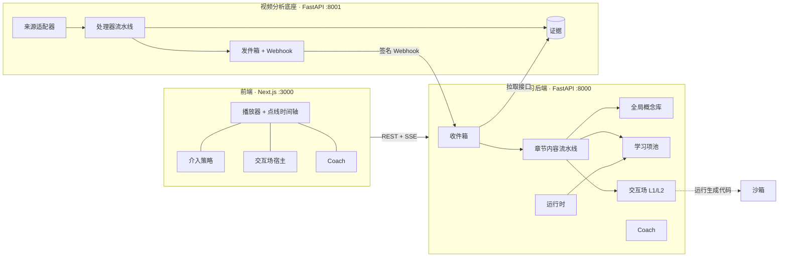

# SeeDots

**See the dots. Connect them.**

[English](README.md) | 简体中文


SeeDots 给你正在看的教学视频加一层 AI：在恰当的时刻出现可验证的学习动作（题目、预测、实验、回看），
每个答案都指回视频里的具体时刻，不同视频里遇到的知识点会连成一张知识地图。

> **状态**：早期开发（pre-alpha），为比赛 MVP 构建（目标 2026 年 11 月）。接口和数据模型随时可能变化。
> 目前只支持英文视频。

## 目录

- [功能](#功能)
- [工作原理](#工作原理)
- [快速开始](#快速开始)
- [配置](#配置)
- [运行测试](#运行测试)
- [目录结构](#目录结构)
- [文档](#文档)
- [设计原则](#设计原则)
- [已知差距与路线图](#已知差距与路线图)
- [参与开发](#参与开发)
- [许可证](#许可证)
- [致谢](#致谢)

## 功能

- **任何视频都能接入。** 粘贴 YouTube 链接（只用官方嵌入播放器，只读字幕，从不下载视频）、上传文件（字幕可选），
  或从你有权使用的网页抓取视频。没有字幕的视频在配置了语音识别后会自动转写。
- **题目提前备好。** 每一章都会被整理成知识点和一个经过校验的题目池：单选、多选、找错、预测、排序、配对。
  每道题都引用支撑答案的逐字稿句子。
- **尊重学习者的打断。** 播放器识别自然停顿、反复回看、跳过和“疑惑”标记。前端决定**何时**可以打扰
  （频率上限、专注模式、连续关闭后静音），后端决定**出什么**。
- **AI Coach。** 流式回答你当前所在时刻的问题，附可点击的时间点，标出不来自视频的内容，
  还能查到你在其他视频里在哪学过同一个概念。回答按 Markdown 渲染，支持 LaTeX 公式。
- **交互场。** 先预测、再动手、看结果、最后解释。L1 是预置组件（函数图像、迭代过程）的配置，由代码校验；
  L2 由编码 agent 按需生成，只有通过脚本化检查后才在隔离沙箱里运行。
- **知识地图。** 概念跨视频合并进全局概念库；提供地图、概念页、搜索，以及需要你确认的知识卡片。
- **模型调用可观测。** 所有模型调用都经过同一个网关：提示词版本化、类型化输出、缓存、预算和调用日志（`GET /api/usage`）。

## 工作原理



1. **视频分析底座**（`services/seedots/media`）把任意视频变成带时间轴的**证据**（句子、章节、关键帧），它不了解“学习”。
2. **学习后端**（`services/seedots/learning`）消费章节事件，离线逐章生成概念、题目和交互场，从当前播放位置往后优先。
3. 观看时，**运行时**只查表：从预先生成的题目池里挑动作和题目。在线调用模型的只有 Coach、动作选择和知识卡草稿。

两个服务各有自己的数据库、工作流和模型网关，只通过 HTTP 和签名 Webhook 交互。完整设计见[技术方案](docs/tech-plan.md)。

## 快速开始

### 环境要求

- macOS 或 Linux
- Python 3.11+
- Node.js 20+
- ffmpeg
- Google Chrome（只有 L2 交互场需要，以无头模式使用）
- 一个 OpenAI 兼容接口的密钥（默认 [TokenRouter](https://www.tokenrouter.com)）。没有密钥也可以用离线假模型跑通全部流程。

### 安装

```bash
git clone https://github.com/JerryLinyx/seedots.git
cd seedots
cp .env.example .env            # 填 SEEDOTS_LLM_API_KEY；没有密钥时把 SEEDOTS_LLM_FAKE 设为 1

# 后端
cd services && python3 -m venv .venv && .venv/bin/pip install -e '.[dev]' && cd ..

# 前端
cd apps/web && npm install && cd ..

# 可选
(cd services/scenekit && npm install)   # L2 交互场（无头 Chrome 沙箱）
(cd services/grabber && npm install)    # 从网页添加视频
```

### 运行

```bash
scripts/dev.sh
```

会启动底座 `:8001`、学习后端 `:8000` 和前端 `:3000`。打开 <http://localhost:3000>，首页已填好示例 YouTube 链接。
`Ctrl+C` 同时停止三个进程。

> 如果某个服务报 `address already in use` 并退出，说明端口还被别的进程占着（例如上一次运行没停干净）。
> 停掉它，再重新运行 `scripts/dev.sh`。

## 配置

所有设置都是环境变量，从仓库根目录的 `.env` 读取。常用项如下，完整列表和说明见 [`.env.example`](.env.example)。

| 变量 | 默认值 | 作用 |
| --- | --- | --- |
| `SEEDOTS_LLM_API_KEY` | — | 模型接口密钥 |
| `SEEDOTS_LLM_BASE_URL` | `https://api.tokenrouter.com/v1` | OpenAI 兼容接口地址 |
| `SEEDOTS_LLM_MODEL` | `deepseek/deepseek-v4-flash-0731` | 所有任务的默认模型 |
| `SEEDOTS_LLM_FAKE` | `0` | `1` = 离线假模型（只用于开发和测试） |
| `SEEDOTS_LLM_REASONING` | `auto` | 推理强度：`auto`（按任务）、`off`、`low`、`medium`、`high` |
| `SEEDOTS_LLM_MAX_TOKENS` | — | 按任务覆盖输出上限，如 `scene_code=48000,items=20000` |
| `SEEDOTS_EMBED_MODEL` | — | 概念召回用的向量模型（不配则用本地字面相似度） |
| `SEEDOTS_ASR_MODEL` | — | 没有字幕的视频用的语音识别 |
| `SEEDOTS_VLM_MODEL` | — | L2 截图审查用的视觉模型（不配置时这一关记为“跳过”并在界面上写明） |
| `SEEDOTS_SANDBOX` | `local` | L2 代码在哪里运行：`local`（无头 Chrome）或 `off` |
| `SEEDOTS_ACTION_SELECTOR` | `llm` | `llm`（出错时回退规则）或 `rule` |
| `SEEDOTS_WORKFLOW_ENGINE` | `inprocess` | `inprocess` 或 `temporal`（需 `pip install -e '.[temporal]'`） |
| `SEEDOTS_MEDIA_DB_URL`、`SEEDOTS_LEARNING_DB_URL` | `data/` 下的 SQLite | 换 PostgreSQL 需 `pip install -e '.[postgres]'` |

推理模型的思考也计入输出上限。某个任务报 “token limit exceeded before any response” 时，用
`SEEDOTS_LLM_MAX_TOKENS` 调大它的上限。

提示词在 `services/seedots/*/prompts/<task>.v<N>.md`。改提示词 = 新增一个版本；默认用最新版本，个别任务可以固定版本。

## 运行测试

测试用离线假模型运行，不需要密钥：

```bash
cd services && .venv/bin/python -m pytest
```

沙箱相关测试只在安装了 `services/scenekit` 依赖时运行，否则跳过。前端有类型检查：

```bash
cd apps/web && npm run typecheck
```

## 目录结构

```
apps/web/                    Next.js 前端（只做前端，业务全部在学习后端）
  components/                播放器、点线时间轴、Coach、题目和交互场视图、知识地图
  lib/policy.ts              介入策略：什么时候可以打扰
  lib/expr.ts                L1 交互场的表达式语言（与后端同一套语法）
services/
  seedots/common/            共享内核：证据契约、数据库、模型网关（llm/）、工作流端口
  seedots/media/             视频分析底座（:8001）：来源、处理器、Webhook
  seedots/learning/          学习后端（:8000）
    catalog.py               视频镜像、章节、证据快照、收件箱
    concepts.py              全局概念库：精确匹配、召回 + 判定、合并与回滚
    pipeline.py              每章：快照 → 概念 → 题目 → 补缺 → 交互场
    item_types.py            题型注册表：payload、答案、校验器、评分器
    runtime.py               动作选择（模型优先、规则兜底）、评分、掌握度
    coach.py                 上下文包、白名单工具、引用
    knowledge.py             知识地图、概念页、知识卡片、搜索
    scenes/                  L1 配置、Scene Kit、沙箱端口、L2 工作流
    prompts/                 版本化提示词
  scenekit/                  L2 交互场的本机无头 Chrome 沙箱（Node + playwright-core）
  grabber/                   网页视频抓取（Node）
  migrations/                Alembic 迁移，每个服务一套
  tests/                     离线测试
scripts/dev.sh               一键启动三个进程
docs/                        产品与工程文档（中文）
```

## 文档

工程文档用中文书写，和代码一起维护。

| 文档 | 内容 |
| --- | --- |
| [`docs/prd.md`](docs/prd.md) | 需求文档（R01–R27）：做什么 |
| [`docs/tech-plan.md`](docs/tech-plan.md) | 技术方案：怎么做、需求追溯、实现状态 |
| [`docs/api.md`](docs/api.md) | 两个服务的 HTTP 接口（由测试保证与路由一致） |
| [`docs/database.md`](docs/database.md) | 数据库设计与迁移历史 |
| [`docs/progress.md`](docs/progress.md) | 里程碑、任务看板、周报 |

## 设计原则

以下原则贯穿整个代码库，破坏它们的改动不会被接受。

1. **时间只有一个来源。** 模型不输出秒数，只引用证据 ID（如 `s0042`），时间戳由证据给出。
2. **在线只查表。** 学习者等待时不生成题目、不解析视频；在线的模型调用只做选择和短文本。（L2 交互场是用户主动请求、显示进度的生成。）
3. **事实由代码算。** 评分、实验结果和预测答案都由确定性代码计算；模型输出必须通过校验才能发布，只有人工审过的题目计入掌握度。
4. **YouTube 只嵌入，不下载。** 只用官方播放器，不遮挡、不修改。

## 已知差距与路线图

与技术方案有意不同、之后会替换的部分：

| 方案 | 现在 | 下一步 |
| --- | --- | --- |
| YouTube 由模型直读链接，加画面证据 | 用 yt-dlp 读元数据和平台字幕轨（不下载视频）；关键帧只对自有文件生成 | 换成 Data API + oEmbed + 模型读链接；接视觉模型后增加区域证据 |
| L2 托管代码沙箱 | 本机无头 Chrome（同一 JSON 协议） | 换成实现 `Sandbox.run` 的托管沙箱 |
| 托管认证 | 请求头 `X-SeeDots-User`（默认 `demo`） | 接认证服务，替换 `current_user` |
| pgvector | 向量存 JSON，召回在应用里算 | 见 [`docs/database.md`](docs/database.md) |
| 测评门禁 | 未做 | 20 个视频的黄金集 + 校准过的模型评委 |

Temporal 适配层还没有在真实的 Temporal 服务上运行过，第一次启用时请留意日志。后续计划见
[`docs/progress.md`](docs/progress.md) 的任务看板。

## 参与开发

SeeDots 由一个小团队开发，暂不接受外部贡献。如果你要参与：

- 先读 [`CLAUDE.md`](CLAUDE.md) 里的工作约定（人和 AI 都适用）。
- 改了设计（架构、数据模型、接口、不变量、重要的默认值），要在同一次提交里更新
  [`docs/tech-plan.md`](docs/tech-plan.md)，并在“变更记录”里写一行；新增迁移要在
  [`docs/database.md`](docs/database.md) 里记一行。
- 代码、注释和提交信息用英文；文档用中文。
- 所有模型调用都经过 `services/seedots/common/llm` 网关；提示词是版本化文件。
- 推送前先跑测试。

## 许可证

尚未选定许可证，目前保留所有权利。`services/grabber` 基于 MIT 许可证的 mediagrab。

## 致谢

- [Pydantic AI](https://ai.pydantic.dev)：agent 与网关层
- [FastAPI](https://fastapi.tiangolo.com)、[SQLAlchemy](https://www.sqlalchemy.org)、
  [Alembic](https://alembic.sqlalchemy.org)：后端服务
- [Next.js](https://nextjs.org)、[react-markdown](https://github.com/remarkjs/react-markdown)、
  [KaTeX](https://katex.org)：前端
- [Playwright](https://playwright.dev)：交互场沙箱
- [yt-dlp](https://github.com/yt-dlp/yt-dlp)：读取字幕轨
