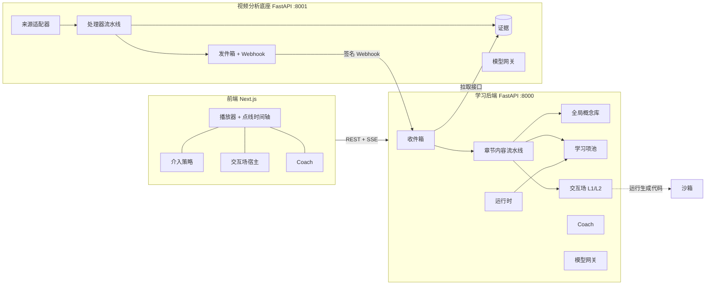

# SeeDots 技术方案

版本 v1.3（2026-10-20）。v1.1 的 Claude 文档已停止更新，以本文件为准。

**维护方式**

- 本文件和代码在同一个仓库、同一次提交里更新：改了设计就改这里；只改实现、不改设计的不用动。
- 人和 Claude 都会直接编辑本文件。编辑前先拉取最新版本，在原文上增改，不整篇重写；有冲突时以人写的内容为准，并在“变更记录”里写一行。
- “实现状态”只写仓库里真实存在且有测试覆盖的东西；没跑通的写“未验证”，没做的写“未做”。
- “做什么”以 [`prd.md`](prd.md) 为准，本文只讲“怎么做”，需求编号沿用 R01–R27、场景编号沿用 S1–S10。标“可变”的内容可以直接改，不需要评审。
- 章节结构参照常见设计文档（背景与目标 → 总体设计 → 详细设计 → 备选方案 → 非功能 → 部署运维 → 风险 → 排期）。为了不打乱已有引用，新增内容放在 §0 和 §11 之后，原 §1–§10 编号不变。

---

## 0. 目标与非目标

**背景**：比赛要求 11/9 交付可运行的 MVP，11/10–21 现场路演（PRD §8）。PRD 的 P0 需求集中在三件事：观看中按行为在恰当时刻介入（R08、R09、R15）、先诊断再选教学动作（R10–R14）、跨视频连点成线（R16、R17）。

**目标**（按优先级）：

1. **路演主路径可现场运行**：PRD §8.2 的 A–D 四段演示能在缓存数据上稳定跑完，网络或模型故障时不中断。
2. **三条不变原则在全部代码路径上成立**（§1）：时间只来自证据、在线只查表、事实由代码算。
3. **可度量**：PRD §9、§11 的每个指标都有采集点，路演前能报出解析质量、延迟和成本的实测值。
4. **可替换**：模型、向量、ASR、沙箱、编排、托管都在端口后面，替换不改骨架（§10）。

**非目标**（MVP 阶段明确不做，和 PRD §5“暂不考虑的需求”一致）：

- 任意视频的全自动理解、实时全量视频分析、强化学习训练、IRT 校准。
- 下载、缓存或存储 YouTube 视频本身；B 站、抖音、TikTok（R23）。
- 账号体系与跨设备登录（当前用请求头占位用户）；教师端。
- 多语言：首版只支持英文。
- 学习效果的因果结论：只写对照实验计划，不宣称结果（PRD §9）。

**成功标准**：§11 需求追溯表里所有 P0 行在 11/9 前达到“已实现”且有测试；§12 的延迟、成本在真实模型上实测达标或给出差距；演示录屏完成。

---

## 1. 系统本质

SeeDots 的本质是：**把一段视频变成带时间轴的证据，再把证据变成“在恰当时刻出现的、可验证的学习动作”。** 一切功能都是这条链上的一环。

- **证据**（视频里说了什么、画面上有什么、在哪一秒）是唯一的事实来源。题目、解释、实验、连线、Coach 的回答都必须能回指到证据。
- **学习动作**（题目、实验、补学片段、解释、连线）是在证据之上预先生成、校验、发布的内容，属于与视频共享范围一致的公共资产。
- **学习者状态**（作答、行为、掌握、知识地图）是个人的，只追加记录，派生结论可以随时重建。

三条不变原则，任何模块的实现都不能违反：

1. **时间只有一个来源。** 模型不输出秒数，只引用证据 ID；时间戳由证据单元给出。
2. **在线只查表，离线做生成。** 用户等待的路径上不生成题目、不解析视频；模型只做选择和短文本推理。（L2 交互场是用户主动请求、明确展示进度的离线生成，不在等待路径上。）
3. **事实由代码算，模型只负责解释和选择。** 数值、实验结果、评分由确定性代码完成；模型的输出必须通过校验才能发布，且只有人工审过的内容计入掌握。

## 2. 总体架构

- 底座和学习后端是两个服务，各有自己的数据库、工作流和模型网关，只通过底座的 HTTP 接口和 Webhook 交互。
- 学习后端是模块化单体：catalog、concepts、pipeline、items、runtime、coach、knowledge、scenes，各模块只通过函数接口和 ID 交互。
- 所有模型调用都经过网关；所有长任务都是工作流。

## 3. 核心数据模型

数据分三层：**内容层**（共享、不可变、带版本）、**日志层**（个人、只追加）、**派生层**（个人、可从日志重建）。完整表结构见 [`database.md`](database.md)。

| 对象 | 层 | 归属 | 本质 | 关键字段 |
| --- | --- | --- | --- | --- |
| `evidence_unit` 证据单元 | 内容 | 底座 | 视频某一时间区间里的一条可引用事实 | id、media_id、revision、t0、t1、kind（sentence / chapter / keyframe / region）、content、bbox、source、processor@version、confidence、needs_review |
| `concept` 规范概念 | 内容 | 学习后端，全局 | 跨视频、跨用户的同一个知识点 | id、name、aliases、misconceptions、embedding、status / merged_into + 合并日志 |
| `occurrence` 出现 | 内容 | 学习后端 | 概念在某视频某章的一次出现 | concept_id、media_id、chapter_id、evidence (id, revision)、role |
| `learning_item` 学习项 | 内容 | 学习后端 | 可推给学习者的题目（不可变版本） | id、item_key、version、type、payload、answer_key（仅服务端）、concepts、evidence (id, revision, role)、level、review_status |
| `scene_spec` 交互场 | 内容 | 学习后端 | 一章的可交互实验（L1 配置或 L2 代码） | level、component、spec、status、progress、gates、evidence |
| `learning_event` 学习事件 | 日志 | 学习后端，个人 | 学习者做过的一切 | event_id、user、session、media_time、client_seq、type、payload |

决策、作答、标记、Coach 消息也是日志层的独立表；掌握度、跨视频连线、知识卡片是派生层。

三个关键约束：

- **引用只用 ID + revision。** 学习项、出现、交互场、Coach 引用、知识卡片都存 `(evidence_id, evidence_revision)`；纠错产生新 revision，旧引用不失效。学习项本身也是版本化的：修改 = 新版本，作答指向具体版本。
- **共享范围跟着视频走。** 公开视频的证据、学习项、交互场全局共享；上传和网页来源只对本人可见。
- **答案不下发。** 前端拿到的学习项不含 `answer_key`，评分在服务端；交互场的预测答案同样只存在服务端（前端在学习者动手后用同一套代码算出结果）。

## 4. 视频分析底座

独立服务，输入任意视频，输出领域无关、带时间轴的证据。它不知道“知识点”和“题目”。

**来源适配器**（`media/sources.py`）决定怎么拿到视频，并在登记时声明能力（`has_file / frames / native_seek / playback`），下游据此降级：

| 适配器 | 获取 | 持有文件 | 授权依据 | 实现状态 |
| --- | --- | --- | --- | --- |
| Upload | 直接上传，字幕文件可选 | 是 | 上传者 | 已实现 |
| Platform（YouTube） | 官方元数据 + 平台字幕轨；只用官方嵌入播放器，不下载视频 | 否 | 平台条款 | 已实现（未在真实 YouTube 上验证）；“模型直读链接”未做 |
| WebPage | 网页嗅探后下载（`services/grabber`，来自 Kiwi/mediagrab） | 是 | 用户声明有权 + 记录来源；DRM 不支持 | 已实现（未在真实网页上验证） |

**处理器流水线**（`media/processors.py`）。每个处理器是一个工作流步骤，以（media、步骤、处理器版本）为幂等键，按来源能力决定是否参与：

1. `fetch`：取文件和字幕。
2. `transcript`：有字幕先用字幕；没有字幕且持有文件时走 ASR（OpenAI 兼容 `/audio/transcriptions`，可配置）。得到逐句证据，带置信度和 `needs_review`。
3. `outline`：章节边界。来源顺序：平台创作者章节 → 大纲模型（只引用句子 ID）→ 固定窗口（标记待审）。
4. `publish`：发出 `media.outline_ready`，再按“当前播放位置往后优先”逐章发出 `media.chapter_ready`。学习后端从这里开始生成内容，第二遍仍在进行。
5. `keyframes`（第二遍）：持有文件时按场景切换抽关键帧证据。区域证据（公式、图表、代码）需要视觉模型，**未做**。
6. `complete`：`media.analysis_completed`。

新增处理器 = 一个类 + 流水线里一行。

**质量**：证据带置信度和 `needs_review`；用户在逐字稿上纠错生成新 revision，并发出 `media.evidence_revised`。

**对外接口**（`media/api.py`）：

- 命令：`POST /v1/media`（登记，可同时开始解析）、`POST /v1/media/upload`、`POST /v1/media/{id}/analyze`（`priority_from` = 播放位置）、`PATCH /v1/evidence/{id}`（纠错）。
- 查询：媒体状态与各步骤、章节、按区间和类型取证据、按 revision 取单条证据、文件与关键帧。
- 事件：`media.registered / outline_ready / chapter_ready / evidence_revised / analysis_completed / failed`。持久化发件箱与状态变化同事务提交；按订阅投递，HMAC 签名，指数退避，失败 12 次进入死信，可人工重放；`GET /v1/events?media_id&after_seq` 作为拉取兜底。调用方按 `event_id` 幂等消费、按 `seq` 容忍乱序。前端进度由学习后端转成 SSE。

**编排**：工作流端口（见第 8 节），本地用进程内引擎，生产用 Temporal。首版只支持英文。

## 5. 学习内容生成

学习后端消费 `media.chapter_ready`，把证据变成概念、学习项池和交互场。目标：**每个概念的每一档难度，在用户到达之前都至少有一个已校验的学习项。**

**收件箱**（`learning/catalog.py`）：按 `event_id` 去重；不信任事件体里的状态，统一回到底座拉取最新状态，所以乱序和重复都无害。

**每章流水线**（`learning/pipeline.py`，固定工作流，不是自主 agent；以（章节、流水线版本）为幂等键，每步结果记在 `content_runs.stats`）：

1. `snapshot`：把本章引用的证据 revision 复制到本地快照。
2. `concepts`：抽取概念 → 归一进全局概念库 → 写出现位置。归一三档：
   - 规范名或别名精确命中 → 直接挂上；
   - 否则向量召回最近的候选，由模型判定是否同一概念，置信度 ≥ 0.75 挂上；
   - 判定不确定（0.4–0.75）→ 新建概念，同时生成一条待人工确认的合并候选。
   合并会记录移动过的每一行（出现、学习项、别名、误区、掌握度、卡片、连线），可以完整回滚。没有配置向量模型时用本地字面相似度兜底，只能识别拼写变体。
3. `items`：基础学习项池。题型是注册表（`item_types.py`），每个题型注册 payload schema、答案 schema、校验器、评分器；前端按 type 注册渲染组件。已实现题型：单选、多选、找错、预测、排序、配对。校验：结构 → 证据（引用的句子必须属于本章）→ 预测题的揭晓句必须在证据内且足够靠后 → 提示不能泄露答案。未通过的草稿存入 `item_rejections` 供测评使用。自动校验通过即可推给用户；**只有人工审过的才计入掌握**。
4. `gap_fill`：按“概念 × 难度”找空格，针对缺口再生成一次（尽力而为，失败不影响已有题目池）。
5. `scene`：最多一个 L1 交互场（见下）。

带信心作答、参数实验题型、补学片段题型、“不同概念之间的关系推断”：**未做**。同一规范概念的跨视频连线已实现（见第 6 节的连线卡）。

### 交互场：L1 与 L2

|  | L1 组件配置 | L2 代码生成 |
| --- | --- | --- |
| 产出 | SceneSpec：预置组件的配置 | 一段 Scene Kit 代码 + 参数与预测声明 |
| 组件 / 引擎 | `function_plot`（y = f(x; 参数)）、`iteration`（xₙ₊₁ = g(xₙ; 参数)，可画在目标函数上） | canvas（默认）、JSXGraph、Matter.js、Three.js，从固定 CDN 按固定版本加载 |
| 触发 | 章节流水线自动生成 | 学习者在“Try it yourself”里描述需求 |
| 时延 | 秒级 | 分钟级，页面实时显示真实阶段 |
| 运行 | 学习页内，前端 SVG 渲染 | `sandbox="allow-scripts"` 的 iframe；运行页带 CSP sandbox 响应头；只能通过 kit 与宿主通信 |
| 生成者 | 结构化输出调用，失败时带校验信息重试一次 | Pydantic AI 编码 agent，工具 `run_checks`，最多 6 次模型请求 |
| 发布关卡 | 表达式白名单、参数全量程可画、默认值不发散、预测能产生可见变化、证据属于本章 | 静态规则 → 沙箱脚本化交互 → 工作流独立复核 → 截图视觉审查 |

**共同流程**：先预测（滑块锁住）→ 动手调参数 → 看结果并和预测对比 → 用自己的话解释（交给 Coach 检查）。事件 `scene.open / predict / set_param / observe / explain / request` 进入学习事件日志。

**事实由代码算**：
- L1 的表达式语言（`scenes/expr.py`）只有数字、四则与幂、参数名、x / n、常量和函数白名单，没有属性访问和 eval。前端 `lib/expr.ts` 是同一套语法的逐行移植，已对比验证结果一致。预测答案由服务端用它算出，不下发。
- L2 的预测答案由沙箱实际运行场景得到：把参数设为默认值和目标值，读取场景上报的观测值。

**Scene Kit**（`scenes/kit.py`）是 L2 代码唯一可用的接口：
- `kit.param` 声明控件（宿主渲染）、`kit.get`、`kit.onChange`、`kit.canvas`、`kit.colors`、`kit.observe` 上报观测、`kit.ready`。
- 事件协议：场景 → 宿主 `ready / observe / ack / error`；宿主 → 场景 `set_param`。前端只信任场景确认已应用目标值（`ack`）之后的观测。
- 场景在框架有尺寸后才启动（否则画布宽度为 0）。
- 静态规则禁止：网络、动态代码、模块加载、访问宿主页面、存储、导航、HTML 注入、worker、script 标签。

**沙箱端口**（`scenes/sandbox.py`）：本地实现用无头 Chromium（`services/scenekit`，Node + playwright-core）；生产换成托管沙箱，只需实现同一个 `Sandbox.run` 契约。脚本化闸门：等 `ready`，每个控件拉到两端再回到默认值并等待确认，检查控件与声明一致、无报错、有观测、画面非空白，然后执行预测场景。

**L2 工作流**（`learning.scene`）：`draft`（agent 写代码并自测）→ `verify`（独立复核 + 截图）→ `review`（视觉模型看截图；未配置视觉模型时记为“跳过”并在界面上写明）→ `publish`。任何一关失败，场景标记为失败并显示原因，不发布未验证的场景；学习者仍有 L1 和题目可用。

L2 场景挂在视频上，共享范围跟随视频。

## 6. 学习运行时

运行时把“什么时候介入”和“介入做什么”拆开：**前端在本地判断时机，后端选择动作，内容从预先生成的学习项池里挑。**

- **时机（前端，`lib/policy.ts`）**：
  - 从播放器状态推断信号：反复回看、长暂停、章节结束、跳过、疑惑标记、预测窗口（揭晓前 25 秒内）、遇到在别的视频里学过的概念。
  - 硬约束在前端直接拦截，模型不能绕过：只在自然停顿点出现（预测窗口和连线卡例外，它们在视频旁边，不暂停视频）、每 5 分钟上限（用户可调）、专注模式、同类卡片连续关闭两次后静音 10 分钟。
  - 程序化跳转（恢复上次位置）之后有短暂静默，不算用户跳过。
  - 同一时间只显示一张卡片。
- **动作（后端，`ActionSelector`）**：
  - 每种信号只允许一组候选动作，例如预测窗口只能“不打断 / 预测题”，跨视频概念只能“不打断 / 连线卡”，疑惑标记只能“解释”。
  - 默认实现调用模型，从候选里选一个并给出理由。输入：信号、当前段落证据、掌握度、最近打扰历史、学习目的。
- **规则是底线**：规则选择器每次都计算并记录；模型出错时直接使用规则结果；两者的差异就是对照数据。查上下文、调模型、写决策分三段短事务，模型调用期间不持有数据库事务。超时上限待实测后设定。
- **内容（不生成）**：按动作、章节、难度从学习项池挑选，优先选难度贴近当前掌握度、且已人工审过的。
- **评价与掌握**：服务端按学习项版本评分。只有“已人工审过 + 首次作答 + 未用提示”的作答计入掌握。规则阶梯：连续两次独立答对升一级，独立答错降一级；独立、辅助作答分开计数。交互场的预测结果目前只记事件，不计入掌握。
- **一切都是事件**：播放、标记、卡片展示与关闭、作答、决策（含规则结果、选择器、是否回退、延迟）都写入只追加的表，按 `event_id` 去重。

## 7. AI Coach

Coach 是唯一一个在线使用工具调用的 agent。它的速度来自**不发视频**：回答只用预建好的文本上下文，必要时再用工具取更多。

- **上下文包**：当前时刻前 90 秒、后 30 秒的逐句稿，当前章节，本章概念和常见误区，学习者附近的标记，最近答错的题。
- **工具**（白名单，每次请求重新绑定用户和视频，工具里拿不到其他用户的数据）：
  - `transcript_around(sentence_id)`：读本视频更多上下文；
  - `concept_elsewhere(name)`：在学习者能看的其他视频里找同一概念，结果以 `o1`、`o2` 引用。
- **回答规则**：先简短回答，再追问一句；视频里的说法附句子 ID，服务端解析成可跳转时间点；视频之外的知识必须标“(not from the video)”，存为外部引用。
- **对话记忆**：每个（用户、视频）一个线程；跨视频的内容通过概念检索获得。
- **输出**：SSE 流式；回答和引用都持久化。

**未做**：框选画面提问（需要区域证据）；检索学习者的历史对话。

## 8. Agent、提示词与 Harness

全系统统一使用 **Pydantic AI**：

| 类别 | 例子 | 形态 | 运行位置 |
| --- | --- | --- | --- |
| 结构化任务 | 大纲、概念抽取、概念判定、出题、动作选择、知识卡草稿、L1 交互场、截图审查（带图片） | 类型化输出，一次修复重试 | 工作流步骤或在线请求 |
| 对话 agent | Coach | 白名单工具 + 流式输出 | 在线请求 |
| 编码 agent | L2 交互场 | 工具 `run_checks`（静态规则 + 沙箱），请求数上限 | 工作流 + 沙箱 |

**网关**（`common/llm`）包在 Pydantic AI 外面，只做框架不负责的事：
- 按任务名绑定提示词版本与模型参数，个别任务可以路由到别的模型（如视觉审查）；
- 结果缓存（按任务、提示词版本、模型、渲染后的提示词）；
- 按任务的每日 token 预算；
- 推理模型：`max_tokens` 是思考 + 回答的总上限，按任务给足；模型在给出回答前用完上限时，自动放大 3 倍重试一次（上限 65536）。对延迟敏感的任务（动作选择、Coach、概念判定、知识卡、截图审查）请求 `low` 推理强度；服务商不接受该参数时自动停发。`SEEDOTS_LLM_REASONING`、`SEEDOTS_LLM_MAX_TOKENS` 可整体或按任务覆盖；
- `usage_logs`：任务、模型、提示词版本、token、请求数、耗时、首 token 时间、上下文清单（用了哪些证据、工具、图片数）。

任何模型调用都必须经过它。没有密钥时用离线“假大脑”跑通所有任务（走同一套 agent、校验和流式代码），只用于开发和测试。

**提示词规范**：
1. 按任务存放、带版本：`prompts/<task>.v<N>.md`，分 `## system` 和 `## user` 两段，`{{变量}}` 占位。改提示词 = 新增版本；默认用最新版本，可以固定版本。测评门禁接上后，新版本必须先过门禁。
2. 结构：角色与任务 → 输入契约 → 证据规则 → 输出格式 → 拒答出口。黄金集示例待黄金集建好后补。
3. 输入里的证据都带 ID；输出只能引用这些 ID，不能写秒数。
4. 每个任务都有拒答出口（如没有可教的概念时返回空、没有合适关系时 `scene: null`）。宁可不出题，也不出错题。
5. 误区、动作、关系类型都用受控词表。

**工作流端口**（`common/workflow.py`）：服务把长任务描述成“计划 → 幂等步骤 → 失败钩子”。进程内引擎（线程 + 步骤重试，重启后恢复未完成任务）和 Temporal（一个通用工作流把每一步作为 Activity 执行，`PermanentError` 不重试）跑同一套步骤；一个引擎可以通过 Router 服务多个工作流。底座和学习后端用不同的 namespace。

**实时性靠分通道，而不是靠更快的模型**：

| 通道 | 内容 | 目标 | 手段 |
| --- | --- | --- | --- |
| 热 | 出卡、选学习项 | 用户无感 | 学习项池提前生成；在线只查表 |
| 温 | 动作选择、Coach | 首 token 1–2 s | 预建上下文包；不发视频；流式；模型调用不持有事务 |
| 冷 | 视频解析、学习项生成、L2 | 分钟级但渐进 | 两遍解析、按章发布、从播放位置往后排优先级、产物按版本复用、真实进度 |

**降级阶梯**：L2 实验 → L1 实验 → 题目 → 补学片段 → 只回跳原片。任何一级失败都退到下一级，并在日志里记录原因。

## 9. 测评

测评是发布门禁：**提示词、模型或流水线版本一变就跑，回归超过阈值就拦截。** 数据集和指标在仓库里版本化；trace 与成本接一个 LLM 观测平台。

| 层 | 测什么 | 方法 |
| --- | --- | --- |
| 组件（离线，门禁） | 底座：句级时间误差、章节边界、区域识别；生成：概念召回与归一正确率、学习项有据率与可解性、诊断 Macro-F1；Coach：引用正确率、越界拒答；交互场：L1 不变量通过率、L2 首稿与最终通过率、失败原因分布 | 黄金集 + 确定性检查（ID、时间、数值重算）+ LLM 评委 + 人工抽查 |
| 系统（日志） | 三条通道的 P50 / P95；每个视频和每个活跃用户的成本；卡点判断的精确率与召回率（以“疑惑”标记为标签）；卡片关闭率；规则与模型选择器的差异 | `usage_logs` + 事件日志 + 回放 |
| 学习效果 | 独立新题、延迟保持、提示依赖；交互场预测正确率的变化 | 试点，之后做对照实验；只写计划，不宣称结果 |

- **黄金集**：20 个英文视频，覆盖证据、概念时间点、错因作答样本和 Coach 问答对。
- **LLM 评委**：先和人工标注校准，报告一致率后才能用于门禁；确定性检查能做的不交给评委。
- **可回放**：任何一次生成都能用当时的上下文清单和提示词版本重跑。

当前状态：离线工程测试 34 个（文档与路由一致性、两服务通过 HTTP 全链路、迁移一致性、网关、Webhook、真实沙箱运行、L2 工作流）；表达式前后端一致性已对比验证但未纳入测试。**黄金集、评委、门禁、观测平台都未做。**

## 10. 可变部分与待定事项

以下都是实现选择，替换它们不改变前面的骨架。

| 类别 | 当前选择 | 状态 |
| --- | --- | --- |
| 前端 | Next.js + TypeScript，只做前端，业务 API 全在 FastAPI | 已定；完整 Next 构建未在本仓库验证 |
| 后端 | Python + FastAPI + Pydantic；SQLAlchemy 2 + Alembic（每服务一套迁移）；开发用 SQLite，生产 PostgreSQL | 已定 |
| 向量 | 现存 JSON，应用内计算相似度；上 PostgreSQL 后换 pgvector + HNSW | 待切换 |
| 编排 | 工作流端口；进程内引擎 / Temporal | Temporal 适配已写，未在真实 Temporal 上运行；Cloud 还是自托管待定 |
| Agent 框架 | Pydantic AI，全系统统一 | 已定 |
| 模型 | TokenRouter（OpenAI 兼容），默认 `deepseek/deepseek-v4-flash-0731`；按任务在网关配置 | 未用真实密钥验证；按测评结果选 |
| 向量模型、ASR、视觉模型 | 都是可选的 OpenAI 兼容端点 | 待实测选型 |
| L2 沙箱 | 本机无头 Chromium；生产换托管沙箱 | 供应商待定 |
| 托管 | PaaS 组合：前端托管 + 容器平台 + 托管 Postgres | 具体平台待定 |
| 身份 | 托管认证服务；当前用请求头 `X-SeeDots-User` 占位 | 供应商待定 |
| 观测 | 自建测评 + 一个 LLM 观测平台 | 平台待定 |
| 题型、组件、引擎清单 | 见第 5 节 | 可随时增减 |
| 介入阈值、频率上限、动作选择超时 | 先用默认值，按试用数据调 | 待定 |
| 语言 | 首版英文 | 中文后续再加 |

**需要和团队对齐的冲突**：

- **YouTube 解析方式（与 PRD §11 决议不一致）**：PRD 决定 YouTube 视频“由 Gemini 直接读链接解析，yt-dlp 只用于自有或授权素材”。现在的 YouTube 适配器用 yt-dlp 的 `--skip-download` 只读元数据和平台字幕轨，不下载视频，但仍然在 YouTube 上用了 yt-dlp。计划：新增 `GeminiLinkProcessor`（模型读链接，只输出句子 / 章节证据，时间仍由证据给出）和 YouTube Data API v3 + oEmbed 元数据适配器，替换 yt-dlp 路径；替换前书面材料按 PRD 口径写。见 §13 备选方案 A。
- **路演缓存标识**：PRD §8.1 要求“路演使用预先解析好的缓存，界面上标明”。底座的产物可复用，但没有“演示快照”导入导出和界面标识。计划见 §14。
- **界面布局**：PRD §6.1 是三栏（导航 / 视频 / 学习侧栏），现在是两栏（视频 + 侧栏，导航在顶部）。属于交互方案范围，等 10/26 交互方案定稿后再改。
- **范围与时间**：PRD 把生成式交互（R21）列为 P2，本方案已实现 L1 和 L2（L2 未用真实模型验证）；独立底座和 20 个视频的黄金集仍是 11/9 前的主要风险。
- **语言**：首版只支持英文，演示课程需要重新挑选。
- **时延指标**：动作选择暂不设超时，和 PRD“触发后 2 秒内出卡”需要用实测数据对齐。
- **网页视频的表述**：书面材料里网页下载能力的写法要和 PRD §11 的合规口径一致。

**11/9 切片**：底座第一遍解析（上传与平台）+ 内容生成（概念、学习项池、L1）+ 学习运行时 + Coach 已在仓库中实现，离线测试通过；下一步是用真实模型和真实视频跑通，并补黄金集。L2 和网页来源已有实现，是否在路演中展示取决于真实模型下的通过率。第二遍区域证据放到路演之后。

## 11. 需求追溯

PRD 每条需求落在哪个模块、哪个接口、哪个测试。状态口径同本文“实现状态”：只写仓库里有、且有测试覆盖的；“部分”后面写缺什么。PRD §5 的“当前状态”列与这里保持一致。

| 编号 | 优先级 | 模块 / 接口 | 测试 | 状态 |
| --- | --- | --- | --- | --- |
| R01 素材输入 | P0 | `media/sources.py`；`POST /api/videos`、`/api/videos/upload` | `test_end_to_end` | 部分：可嵌入检查未做；YouTube 解析方式待改（§10） |
| R02 媒体处理与任务 | P0 | `media/processors.py`、工作流端口；`GET /api/videos/{id}/progress`（SSE） | `test_end_to_end`、`test_platform` | 部分：取消未做 |
| R03 逐字稿 | P1 | `transcript` 处理器、ASR；`Transcript.tsx` | `test_captions` | 部分：全文搜索、待确认标注未做；ASR 未验证 |
| R04 画面理解 | P0（预置） | `keyframes` 处理器 | `test_end_to_end` | 部分：区域证据（公式 / 代码 / 图表）未做 |
| R05 知识组织 | P0 | `learning/concepts.py`、`pipeline.py`；`/api/review/candidates` | `test_end_to_end` | 部分：人工审阅界面未做 |
| R06 题库 | P0 | `learning/items.py`、`item_types.py` | `test_item_types` | 已实现（预审题库内容未整理） |
| R07 学习目的与标签 | P1 | `user_settings.purpose`；`PUT /api/settings` | — | 部分：多选标签、AI 预填未做 |
| R08 行为采集 | P0 | `lib/events.ts`、`lib/policy.ts`；`POST /api/events` | `test_end_to_end` | 已实现 |
| R09 打断控制 | P0 | `lib/policy.ts`（时机）、`learning/runtime.py`（动作）；`POST /api/decide` | `test_end_to_end` | 部分：“稍后再答”未做 |
| R10 框选提问 | P0 | 待做：自有播放器框选层 + region 证据 + Coach 输入 | — | 未做（“问当前这一刻”可用） |
| R11 错因诊断 | P0 | 待做：`POST /api/diagnose`，误区受控词表 + 规则优先 + 模型兜底 | — | 未做 |
| R12 互动实验 | P0 | `learning/scenes/`；`/api/scenes` | `test_scenes` | 已实现 |
| R13 按错因补学 | P0 | `runtime.py` 的 `rewatch` 动作 | `test_end_to_end` | 部分：不按错因选片段（依赖 R11） |
| R14 测验模式 | P0 | `runtime.py` 选题与掌握度 | `test_end_to_end` | 部分：固定测验未做 |
| R15 视频标记 | P0 | `POST /api/marks`（往前补 5 秒）；`LearnView.tsx`、`DotRail.tsx` | `test_end_to_end` | 部分：附想法的输入未做 |
| R16 连线时刻 | P0 | `concept_seen_before` 信号 + `link` 动作；`POST /api/links/{id}` | `test_end_to_end` | 部分：关系类型未做 |
| R17 知识地图 | P0 / P1 | `learning/knowledge.py`；`/api/map`、`/api/cards`、`/api/search` | `test_end_to_end` | 部分：导出未做 |
| R18 学后总结 | P1 | — | — | 未做 |
| R19 画像与历史 | P1 | `attempts`、`mastery`、`decisions` 表 | — | 部分：界面未做 |
| R20 复习提醒 | P2 | — | — | 未做 |
| R21 生成式交互 | P2 | L2 交互场 | `test_scenes` | 部分：模板库未做；真实模型未验证 |
| R22 搜索推荐素材 | P2 | — | — | 未做 |
| R23 其他平台 | P2 | `WebPageAdapter`（需权利声明） | — | 未做 |
| R24 批量上传与合集 | P1 | `collections` 表 | — | 部分：只有表 |
| R25 AI Coach | P0 / P1 | `learning/coach.py`；`POST /api/coach`（SSE） | `test_end_to_end` | 部分：历史对话检索未做 |
| R26 交互式学习与通用题目组件 | P0 | 题型注册表 + `ItemView.tsx`、`InterventionCard.tsx` | `test_item_types` | 部分：信心评分、填空、一句话复述未做 |
| R27 自有播放器 | P0 | `Player.tsx`（HTML5 video） | — | 部分：开源播放器未选型 |

P0 缺口按演示段落排序（对应 §16 排期）：R11 诊断 → R13 按错因补学 → R10 框选（自有播放器）→ R14 固定测验 → R16 关系类型 → R15 附想法 → R09 稍后再答 → R26 信心评分。

## 12. 非功能需求的落实

PRD §11 的目标，在设计上怎么保证、在哪里度量。

| 维度 | 目标（PRD） | 设计手段 | 度量 | 状态 |
| --- | --- | --- | --- | --- |
| 出卡延迟 | 触发到卡片出现中位数 ≤ 1 s，P95 ≤ 2 s | 热通道只查表；动作选择设超时，超时直接用规则结果（规则结果每次都已算好） | `decisions.latency_ms`；前端 `card.shown` 事件减去信号时间 | 部分：超时未设（默认值待实测），端到端延迟未统计 |
| Coach 首 token | 1–2 s | 预建上下文包、不发视频、流式 | `usage_logs` 首 token 时间 | 未在真实模型上测 |
| 解析成本 | 每个视频 ≤ 0.10 美元 | 优先平台字幕；按章生成、产物按版本复用；结果缓存；每任务每日 token 预算 | `usage_logs` 按 media 汇总 | 部分：按 media 汇总的报表未做 |
| 用户成本 | 每活跃用户每月 ≤ 1 美元 | 在线只调动作选择和 Coach；Coach 上下文限长；L2 请求数上限 6 | `usage_logs` 按用户汇总 | 部分：按用户汇总未做 |
| 准确率 | PRD §9 | 证据 ID 校验、学习项校验、拒答出口；只有审过的计入掌握 | §9 黄金集 | 黄金集未做 |
| 打扰程度 | PRD §6.4 | 前端硬约束（§6） | 卡片关闭率、完成率（事件日志） | 约束已实现；统计未做 |
| 可靠性 | 不可嵌入、无字幕、超时都有提示和降级 | 来源能力声明 + 降级阶梯（§8）；工作流重试与失败说明 | 失败原因分布 | 部分：不可嵌入检查未做 |
| 安全 | 密钥只在后端；最小权限 | 密钥只读 `.env`；L2 代码在 iframe 沙箱 + CSP；Webhook HMAC；答案不下发 | 代码审查 | 已实现 |
| 无障碍 | 键盘可完成全部互动；对比度达标；字幕可开关 | 时间轴、卡片、标记都有键盘操作；配色按对比度选取 | 待做一次键盘走查与对比度检查 | 未验证 |
| 隐私 | 行为数据只为本人；可导出；不做注意力判断 | 日志层按用户隔离；Coach 工具每次绑定用户；私有视频随用户删除级联 | — | 部分：导出与采集说明页未做 |
| YouTube 政策 | 不修改遮挡播放器；不下载视频；API 数据 ≤ 30 天 | 只用官方 IFrame 播放器，卡片放在侧栏；`platform_meta_expires_at` 记录过期时间 | — | 部分：到期清理任务未做；yt-dlp 读字幕需替换（§10） |
| 年龄 | 18 岁以上 | 注册时声明（账号体系接入后） | — | 未做 |

## 13. 备选方案与取舍

记录每个关键决定考虑过什么、为什么选现在这个，后续条件变化时据此重新评估。

| 编号 | 问题 | 选项 | 选择 | 理由 / 重新评估条件 |
| --- | --- | --- | --- | --- |
| A | YouTube 视频怎么解析 | ① yt-dlp 下载后自己处理 ② 只读平台字幕轨 ③ 多模态模型直接读链接 | 目标是 ③ + ②（字幕作为句子证据），当前是 ②（通过 yt-dlp） | ① 违反 YouTube 政策；③ 能拿到画面信息但时间戳不可靠，所以模型输出必须落到证据 ID 上，由字幕或模型产出的句子证据提供时间 |
| B | 学习内容什么时候生成 | ① 观看时现场生成 ② 提前生成题库、在线只查表 | ② | 延迟目标 2 s 内；现场生成无法校验。代价是首次解析要等，用“按章发布、从播放位置往后优先”缓解 |
| C | 时间从哪来 | ① 模型输出秒数 ② 模型只引用证据 ID | ② | 模型给的秒数不稳定且不可校验；ID 可校验、可纠错（revision） |
| D | 底座是否独立 | ① 学习后端内一个模块 ② 独立服务 + Webhook | ② | 底座领域无关、可复用到其他产品；代价是多一个服务和事件一致性，用发件箱 + 拉取兜底解决 |
| E | 长任务编排 | ① 自己写队列 ② Celery 等任务队列 ③ Temporal | 工作流端口：本地进程内引擎，生产 Temporal | 步骤幂等、可恢复、可观测；端口让 MVP 不依赖 Temporal 部署 |
| F | 交互实验怎么来 | ① 只做手写实验 ② L1 组件配置 ③ L2 生成代码 | ② 为主，③ 按需 | ② 由代码校验、秒级；③ 覆盖面大但需要沙箱和多道闸门，失败时降级到 ② |
| G | L2 代码在哪运行 | ① 宿主页面直接执行 ② iframe 沙箱 + CSP ③ 服务端渲染图片 | ②，发布前在无头浏览器里跑闸门 | ① 不安全；③ 无法交互 |
| H | 动作选择 | ① 纯规则 ② 纯模型 ③ 模型优先、规则兜底且全量记录 | ③ | 规则保证底线和延迟；两者差异是离线评测数据 |
| I | 概念跨视频归一 | ① 只按名字 ② 向量召回 + 模型判定 + 人工候选 | ② | 名字匹配漏掉同义词；判定不确定的进入人工候选，合并可回滚 |
| J | 数据库 | ① 文档库 ② PostgreSQL（开发用 SQLite） | ② | 关系约束（版本唯一、合并审计）要落在库里；pgvector 可替代独立向量库 |
| K | Agent 框架 | ① 直接调 SDK ② LangChain 等 ③ Pydantic AI + 自有网关 | ③ | 类型化输出与校验是核心需求；网关统一提示词版本、缓存、预算、日志 |

## 14. 部署、发布与运维

**环境**：

| 环境 | 用途 | 数据库 | 模型 | 编排 |
| --- | --- | --- | --- | --- |
| 本地 | 开发 | SQLite | 假大脑或真实密钥 | 进程内 |
| 测试 | CI，每次推送 | SQLite（迁移在 PostgreSQL DDL 上渲染检查） | 假大脑 | 进程内 |
| 演示 | 路演 | PostgreSQL 或 SQLite 快照 | 真实密钥 + 缓存 | 进程内 |
| 生产（路演后） | 公开试用 | 托管 PostgreSQL + pgvector | 按测评选型 | Temporal |

**发布**：前端、学习后端、底座各自独立部署。数据库迁移随服务启动自动执行（`SEEDOTS_AUTO_MIGRATE`），每个迁移都能降级；先迁移、再发服务。提示词和处理器都带版本，新版本只影响新生成的内容，旧产物不失效。

**回滚**：服务按镜像回滚；迁移按 `alembic downgrade`；提示词固定到旧版本；生成内容按版本保留，不需要回滚数据。

**路演保障**（PRD §8.1、§8.5）：

- **演示快照**：把演示用视频的证据、概念、学习项、交互场导出成一个快照文件，演示环境启动时导入。界面在使用快照数据的视频上显示“来自缓存”。未做，计划在 11/2–11/6 完成。
- **离线兜底**：模型不可用时，动作选择退回规则，Coach 显示“暂不可用”并给出回跳片段；题目和交互场都来自快照。
- **录屏**：11/7–11/9 录完整备用视频。

**监控**：

- 健康检查：`/health`（两个服务）。
- 模型：`/api/usage`、`/v1/usage`（任务、提示词版本、token、延迟、上下文清单）。
- 事件投递：`/v1/deliveries`（重试、死信），死信可人工重放。
- 告警与集中日志：随托管平台选定后接入，未做。

**数据保留**：YouTube 平台元数据 30 天到期（到期清理任务未做）；学习日志按用户保存，私有视频随用户删除级联。

## 15. 风险

| 风险 | 可能性 | 影响 | 应对 | 负责 |
| --- | --- | --- | --- | --- |
| 真实模型下生成质量不达标（学习项有据率、L2 通过率） | 中 | 高 | 先用 5 个演示视频跑真实模型；演示路径用人工审过的结果；L2 失败降级到 L1 | yuxuan |
| 真实环境延迟超过 2 s | 中 | 中 | 动作选择设超时，超时用规则结果；Coach 流式 | yuxuan |
| YouTube 字幕拿不到或解析方式需替换（§10） | 中 | 高 | 演示视频提前解析进快照；Gemini 读链接作为第二来源 | yuxuan |
| 演示视频不能嵌入 | 低 | 中 | 换可嵌入的 TED 演讲或改用自有素材（PRD §8.5） | 交互负责人 |
| 自有播放器选型拖延，影响框选（R10） | 中 | 中 | 先在 HTML5 video 上做框选叠加层，播放器替换不影响框选接口 | 待定 |
| 黄金集来不及 | 高 | 中 | 先做 5 个视频的小集，书面材料只写计划 | 待定 |
| 单人开发，后端知识集中在一人 | 高 | 中 | 本文件 + `database.md` + 测试作为交接材料 | yuxuan |

## 16. 排期

按 PRD §8.4 里程碑倒排的任务、负责人和进度在 [`progress.md`](progress.md)，本文不再重复。

---

## 变更记录

- **v1.3.2（2026-10-20）**：网关适配推理模型：调高各任务输出上限，用完上限时自动放大重试一次，按任务设置推理强度（第 8 节）。起因：真实模型下 L2 编码 agent 在 8000 token 内只完成了思考，没有给出回答。
- **v1.3.1（2026-10-20）**：新增 [`api.md`](api.md)（接口文档，由测试保证与路由一致）和 [`progress.md`](progress.md)（任务与里程碑）；§16 排期移到 `progress.md`。
- **v1.3（2026-10-20）**：PRD 迁入仓库（`docs/prd.md`），按常见设计文档结构补齐：
  - §0 目标与非目标、成功标准；
  - §11 需求追溯（R01–R27 → 模块、接口、测试、状态，P0 缺口排序）；
  - §12 非功能需求的落实（PRD §11 每项的设计手段与度量）；
  - §13 备选方案与取舍（A–K）；
  - §14 部署、发布与运维（环境、回滚、演示快照、监控）；
  - §15 风险；§16 排期；
  - §10 记录与 PRD 的三处不一致：YouTube 解析方式、路演缓存标识、三栏布局。
  - 标记时间点往前补 5 秒（原为 3 秒），与 PRD R15 一致；新增标记与行为事件的测试。
- **v1.2（2026-10-20）**：移入仓库，按实现更新。产品名改为 SeeDots。新增：
  - 处理器流水线细节、事件补全（`evidence_revised`、`analysis_completed`）；
  - 概念归一三档阈值与可回滚合并；
  - 学习项不可变版本；
  - 每种信号的候选动作集、连线卡；
  - Coach 实际工具集；
  - 交互场完整设计（组件、表达式语言、Scene Kit 协议、沙箱端口、L2 工作流与关卡）；
  - 工作流端口、网关的工具调用 / 图片 / 任务路由；
  - 每一节的实现状态。
- **v1.1（2026-10-20）**：逐模块讨论后定稿，存于 Claude 文档。
